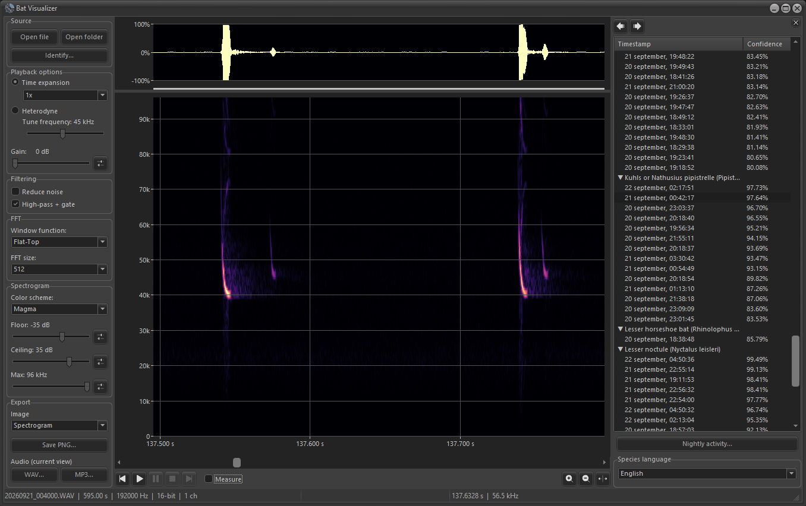
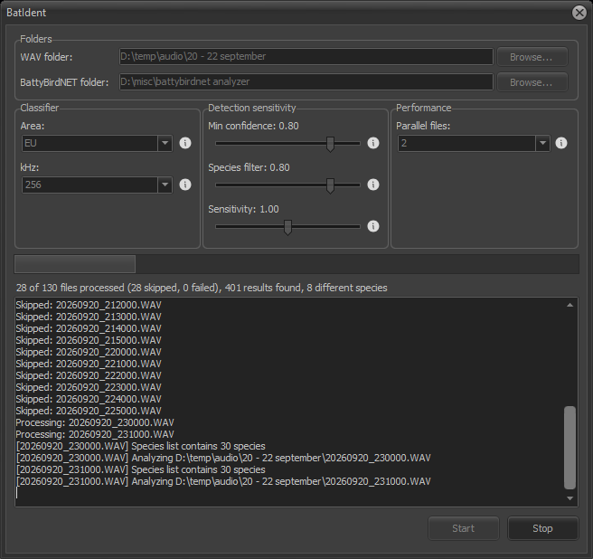

# Bat vizualizer

Bat vizualizer is a Windows desktop application for viewing and analyzing bat echolocation recordings. It loads WAV
files at any sample rate, typically the high rates used by ultrasonic bat detectors, and displays a waveform and
a color spectrogram side by side, with tools to zoom, play back, measure, and export the recording. A bundled
tool called Bat identifyer can additionally run automated species identification over a whole folder of recordings.

## Features

- Waveform and spectrogram view of WAV recordings, each with independent zoom and cursor placement.
- Two playback modes, switchable while a recording is playing. Time expansion slows the whole recording down by
  a chosen factor so the full ultrasonic spectrum becomes audible. Heterodyne instead mixes one narrow, tunable
  frequency band down to audible range in real time, in the same way a handheld bat detector's dial works. Gain
  can be adjusted live in either mode.
- A time and frequency measurement tool. Holding Shift and dragging across the spectrogram reports the duration,
  bandwidth, and slope, in kHz per millisecond, between the two selected points.
- Noise reduction and a high-pass plus gate filter, each with its own independent switch, together with a
  configurable FFT window function and size.
- Ten spectrogram color schemes, including Viridis, Magma, and grayscale in both directions. The floor and ceiling
  of the color range are set automatically whenever a file or a detection is opened, and can be adjusted by hand.
- Export of the current view as a PNG, and export of a zoomed selection as WAV or MP3, the latter by way of LAME.
  The export filename reflects whichever playback mode was selected at the time.
- Export of detection clips: short WAV files cut around each detection in a folder, optionally limited to the best
  results per species or to detections above a confidence threshold, with a configurable margin, and optionally
  with a results CSV file next to each clip, so that the exported folder can be opened like any analyzed folder.
- Folder browsing, so that an entire directory of recordings can be reviewed at once, with per-file and
  per-species detection counts sortable by timestamp or confidence. Species common names are translated into
  Dutch, English, German, French, or Spanish.
- Persistent settings: window position and the most recently used values are restored automatically between
  sessions. They are stored per user in `%APPDATA%\BatViz` and `%APPDATA%\BatIdent`, so the programs also work
  when installed in a folder that is not writable, such as Program Files.
- Bat identifyer, the species identification front end for
  [BattyBirdNET-Analyzer](https://github.com/rdz-oss/BattyBirdNET-Analyzer), which can be run either from inside
  Bat vizualizer or as its own standalone `BatIdent.exe`.

## Quick start

No installation is required to use Bat vizualizer, and no development tools such as Delphi or Python are needed either.
A Windows machine is sufficient.

The ready-to-run programs are published on the
[Releases page](https://github.com/Spifffff/bat_vizualizer/releases/latest) of this repository, and can also be
downloaded directly:

- [BatViz.exe](https://github.com/Spifffff/bat_vizualizer/releases/latest/download/BatViz.exe), the viewer.
- [BatIdent.exe](https://github.com/Spifffff/bat_vizualizer/releases/latest/download/BatIdent.exe), the species
  identification tool.
- [lame_enc.dll](https://github.com/Spifffff/bat_vizualizer/releases/latest/download/lame_enc.dll), which `BatViz.exe`
  needs for MP3 export.

The three files should be downloaded to the same location. Running the program is then a matter of double-clicking
`BatViz.exe`; there is no installer, and no administrator rights are required.

On first launch, Windows will likely display a "Windows protected your PC" warning, because the executable is
not digitally signed. Selecting "More info" and then "Run anyway" proceeds past this warning. This is expected
behavior for a small open-source tool distributed without a paid code-signing certificate, and is not an
indication of a problem with the software itself.

With the exception of automatic species identification, every feature works immediately after extraction: opening
files, both playback modes, filtering, measurement, and PNG, WAV, and MP3 export. Species identification requires
a separate, one-time setup, since it relies on an external Python-based classifier that is not part of this
project. That process is described under Species identification below.

## For users

### Requirements

- Windows. The application is built for 32-bit, though it also runs correctly on 64-bit Windows.
- No additional software for viewing, playback, measurement, or PNG and WAV export, since audio playback uses
  the built-in Windows audio API directly.
- `lame_enc.dll`, placed next to `BatViz.exe`, is required for MP3 export only. A copy is included with each
  release; if another one is ever needed, it can be obtained from
  [lame.buanzo.org](https://lame.buanzo.org/#lamewindl).
- Automatic species identification requires a working installation of
  [BattyBirdNET-Analyzer](https://github.com/rdz-oss/BattyBirdNET-Analyzer), meaning Python together with
  `bat_ident.py`. No other part of Bat vizualizer depends on it.

### Usage

A single recording can be loaded with "Open file", or by dragging a WAV file onto the window, after which the
waveform appears at the top of the window and the spectrogram below it. "Open folder" instead browses every
recording in a chosen folder at once. BattyBirdNET-Analyzer is not required for this: if none of the files in the
folder have been analyzed by Bat identifyer yet, the list on the right simply shows their file names, and it fills in
with species and detection counts once results become available.

Dragging a region on the waveform zooms the spectrogram into that range, and the transport controls step between
files or between individual detections.

Playback begins with the play button. In time expansion mode, the whole spectrum plays back more slowly, at
whichever factor is selected from the dropdown. In heterodyne mode, the recording instead plays back in real
time while tuned to one frequency band, so dragging the tune-frequency slider sweeps that band across the
spectrogram, much as turning the dial on a handheld detector would. The tuned frequency is shown in the
Heterodyne label. Changes to gain take effect immediately, even while playback is in progress.

To measure a call by hand, hold Shift and drag across the spectrogram. Its duration, the frequency range it
swept, and the steepness of that sweep are reported on screen at once. Noise reduction and the high-pass plus
gate filter can each be switched on independently when a recording is noisy, and any of the ten available color
schemes for the spectrogram can be selected according to preference or to suit a particular recording. The
floor and ceiling of the color range are chosen automatically each time a file or a detection is opened, which
usually gives a clear picture at once; the Auto buttons next to the sliders repeat this for the current view,
and the sliders can be moved by hand when a different contrast is wanted.

The Export button in the left panel saves the current view. The file type chosen in the save dialog decides what is
written: the waveform, the spectrogram, or both together as a PNG, or the current zoomed selection as a WAV or an
MP3 file.

Once a folder with Bat identifyer results has been opened, the Export clips button at the bottom of the right
panel cuts a separate WAV file around every detection in that folder, where consecutive results of the same
species that lie within five seconds of each other count as one detection, so there are fewer clips than rows in
the results files. A dialog offers two optional limits, which can be combined: only the best N detections per
species, and only detections above a given confidence. It also sets the margin, in seconds, that is kept before
and after each detection. The clips are written unmodified at the original sample rate, and a progress bar with a
Cancel button is shown while they are being written. A checkbox in the same dialog adds a results
file named like the clip, for example `<clip>.results.csv`, in the same format as the BattyBirdNET output. It holds
a single row, the result that led to the clip, with times counted from the start of the clip, so the exported
folder can be opened in Bat vizualizer like any folder of analyzed recordings.

The Nightly activity button, also at the bottom of the right panel, opens a summary of the detections in the opened
folder, showing for each species how many were recorded in each hour of the night, either for all nights
together or for a single night.

### Species identification

Bat identifyer is a graphical front end for the third-party
[BattyBirdNET-Analyzer](https://github.com/rdz-oss/BattyBirdNET-Analyzer) project, which performs the actual
classification. It is not bundled with Bat vizualizer, since it is a separate Python-based project with its own
installation process, so BattyBirdNET-Analyzer should first be installed by following its own instructions.

Once that installation is complete, Bat identifyer can be opened either through the "Identify..." button inside
Bat vizualizer or by running `BatIdent.exe` on its own. Pointing it at a WAV folder and at the
BattyBirdNET-Analyzer installation folder, then adjusting the classifier and sensitivity settings if the defaults
do not suit a given set of recordings, is all that is needed before pressing Start; each setting has an
accompanying info icon that explains what it controls. The tool also checks the BattyBirdNET folder for the
classifier belonging to the chosen area and sample rate; if it is missing, a note under the Classifier settings
says which rates are available for that area, and Start is blocked until a valid combination is selected.

Results are written next to each WAV file and are shown in the results list, including species, confidence,
per-file and per-species counts, and any files that were skipped or failed during processing. Common names are
displayed in whichever language has been selected.

## For developers

### Implementation

Bat vizualizer is written in Delphi, targeting VCL and Win32, and was developed with Delphi 12. Audio playback calls the
native Win32 `waveOut` API directly, bound dynamically at runtime in [WaveOutPlayer.pas](WaveOutPlayer.pas), so
there is no runtime dependency beyond Windows itself. WAV files are parsed directly in
[WavReader.pas](WavReader.pas), and MP3 files, where opened, are decoded through Windows Media Foundation rather
than through LAME. [LAME](https://lame.sourceforge.io/) is used only on the export side, to encode a selection to
MP3 in [Mp3Writer.pas](Mp3Writer.pas); it plays no part in loading or playing audio. Bat identifyer drives
[BattyBirdNET-Analyzer](https://github.com/rdz-oss/BattyBirdNET-Analyzer)'s `bat_ident.py` as an external
process, from [BatIdentForm.pas](BatIdentForm.pas).

### Project structure

| File | Purpose |
|---|---|
| [BatViz.dpr](BatViz.dpr) | Entry point for the main viewer application |
| [BatIdent.dpr](BatIdent.dpr) | Entry point for the standalone species identification tool |
| [MainForm.pas](MainForm.pas) | Main viewer window: file handling, zoom, playback, filtering, measuring, export |
| [BatIdentForm.pas](BatIdentForm.pas) | Bat identifyer UI: folder selection, analysis options, results |
| [BusyForm.pas](BusyForm.pas) | Busy indicator with optional progress bar and Cancel button for longer operations |
| [ClipExportForm.pas](ClipExportForm.pas) | Dialog for choosing which detection clips to export and the margin around them |
| [NightlyActivityForm.pas](NightlyActivityForm.pas) | Nightly activity summary dialog, with per-species bars by hour |
| [WavReader.pas](WavReader.pas) | WAV file parsing and sample access |
| [WavWriter.pas](WavWriter.pas) | Streaming WAV export of a selection |
| [Mp3Writer.pas](Mp3Writer.pas) | Streaming MP3 export via LAME |
| [FFT.pas](FFT.pas) | Fast Fourier transform used to build the spectrogram |
| [Spectrogram.pas](Spectrogram.pas) | Spectrogram computation and color mapping |
| [SpectrogramPainter.pas](SpectrogramPainter.pas) | Renders the spectrogram bitmap |
| [WaveformPainter.pas](WaveformPainter.pas) | Renders the waveform bitmap |
| [WaveOutPlayer.pas](WaveOutPlayer.pas) | Audio playback via the Win32 `waveOut` API |
| [Heterodyne.pas](Heterodyne.pas) | Mixes and decimates a band down to audible range for heterodyne playback |
| [PngExport.pas](PngExport.pas) | PNG export of waveform/spectrogram bitmaps |
| [BatSpeciesTranslations.pas](BatSpeciesTranslations.pas) | Species common name translations |
| [settings.pas](settings.pas) | Generic ini file backed settings persistence in the per-user application data folder |

### Building

Delphi 12, or a compatible version, with the VCL Win32 platform installed, is required to build the project. The
free Community Edition of Delphi is sufficient; no paid edition or add-on is needed. `BatViz.groupproj`
opens both programs in the IDE at once, and either `BatViz.dproj` or `BatIdent.dproj` can also be opened and
built on its own. Both projects target Win32 only, which is a fixed constraint rather than a preference, since
`lame_enc.dll` is available only as a 32-bit library and determines the platform for the whole build.

No third-party Delphi packages are required, as LAME is loaded dynamically at runtime rather than linked at
compile time. To test MP3 export locally, `lame_enc.dll` should be placed next to the compiled executable.

### Contributing

Issues and pull requests are welcome. This codebase follows a few conventions:

- Two-space indentation, with no manual alignment of adjacent lines.
- Lines kept under 140 characters.
- Every zero-argument call written with empty parentheses, for example `Exit()`, `Obj.Free()`, and
  `TWavFile.Create()`, rather than the bare form.
- Small, focused commits, each with a clear single-line message.

## License

Bat vizualizer is licensed under the GNU General Public License version 3. It may be copied, studied, and modified
freely, and modified versions may be distributed as well, provided they remain under GPLv3 and are accompanied
by their source code. See [LICENSE](LICENSE) for the full text.

## Acknowledgments

- [LAME](https://lame.sourceforge.io/), for MP3 encoding.
- [BattyBirdNET-Analyzer](https://github.com/rdz-oss/BattyBirdNET-Analyzer), for bat species classification and
  for the species and label data behind the name translations.
